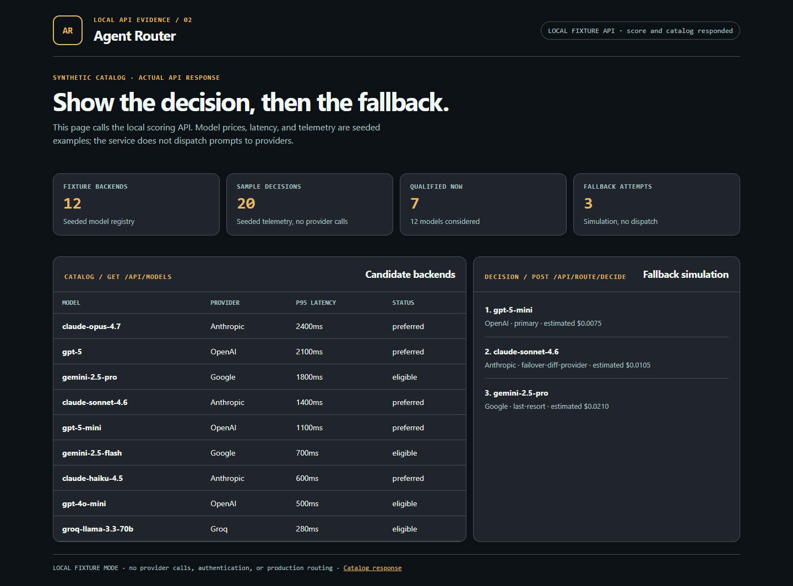

# Agent Router

[](https://github.com/mizcausevic-dev/agent-router/actions/workflows/ci.yml)
[](https://nodejs.org)
[](https://www.typescriptlang.org)
[](LICENSE)

Local routing decision simulator for LLM workloads. It scores a seeded model catalog, builds fallback order, and tracks a process-local circuit breaker.

**Release boundary:** no provider dispatch, real traffic telemetry, sticky sessions, authentication, or tenant isolation exists. The demo binds to `127.0.0.1`; `NODE_ENV=production` refuses to start. Do not route production prompts through it.

## Why This Exists

Model selection can combine capability matching, cost, latency, breaker state, and fallback order. This repository keeps those decisions inspectable with seeded inputs.

This repo isolates the decision logic: capability filter → score against an optimization preference → check process-local breaker availability → build a fallback chain. Telemetry endpoints summarize seeded or caller-supplied decisions; `/api/route/decide` does not emit a new telemetry record.

This reference implementation returns a routing recommendation only. A provider proxy, authorization boundary, and real outcome ingestion remain future work.

## Five Capabilities

### 1. Model Registry

Catalog of 12 example backends across Anthropic, OpenAI, Google, Groq, Fireworks, and Cohere. Capability, price, latency, and quality fields are seeded scoring inputs, not verified current provider specifications or observed traffic.

### 2. Route Scorer

Four optimization profiles, each with explicit weights:

| Profile | Quality | Cost | Latency |
|---|---|---|---|
| `quality` | 70% | 10% | 20% |
| `cost` | 20% | 65% | 15% |
| `latency` | 20% | 10% | 70% |
| `balanced` | 40% | 30% | 30% |

Scoring runs a two-phase pipeline:

1. **Qualification** — exclude non-eligible backends (missing capabilities, context overflow, latency cap exceeded, cost cap exceeded, below quality floor, on excludelist, or non-preferred when `preferredOnly` is set).
2. **Scoring** — normalize quality/cost/latency across the qualified set, apply the optimization weights, add a small bonus for preferred backends.

Returns ranked candidates with full rationale per backend (why it scored what it scored, why disqualified ones were excluded).

### 3. Circuit Breaker

Three-state breaker per model — `closed`, `open`, `half-open`:

- **Closed**: normal routing
- **Open**: failures within rolling window exceeded threshold; backend skipped during routing
- **Half-open**: cooldown elapsed; caller-reported outcomes can close or reopen the breaker

The state machine is covered by local unit tests. Breaker state is process-local, and the API accepts manually supplied outcomes only for known fixture models; no provider health feed is connected.

### 4. Fallback Chain

Given the scored candidates, build an ordered proposed chain:

| Rank | Role | Selection rule |
|---|---|---|
| 1 | `primary` | Highest-scoring qualified backend |
| 2 | `failover-diff-provider` | Best from a different provider (default when `requireProviderDiversity` is true) |
| 3 | `last-resort` | Cheapest qualified candidate from another unused provider when diversity is required |

Cross-provider failover is the default — falling from Claude to Claude doesn't help when Anthropic is the issue.

### 5. Telemetry

Aggregates routing decisions over a window into: total decisions, unique tenants, unique models selected, fallback usage rate, top models by selection share, top tenants, optimization mix, p50/p95 cost + latency, total spend, average qualified-candidate count.

The included telemetry is synthetic and does not update when `/api/route/decide` is called.

## API Endpoints

### Routing

| Method | Endpoint | Purpose |
|---|---|---|
| POST | `/api/route/score` | Score all backends against a routing request; return ranked candidates |
| POST | `/api/route/decide` | Return selected backend + proposed fallback chain; no provider call |

### Models

| Method | Endpoint | Purpose |
|---|---|---|
| GET | `/api/models` | Full backend registry |
| GET | `/api/models/:modelId` | Single backend details |

### Circuit Breakers

| Method | Endpoint | Purpose |
|---|---|---|
| GET | `/api/breakers` | Snapshot of current breaker states |
| POST | `/api/breakers/outcome` | Record success/failure for a model |
| DELETE | `/api/breakers/:modelId` | Reset breaker state |

### Telemetry & Dashboard

| Method | Endpoint | Purpose |
|---|---|---|
| GET | `/health` | Service status |
| GET | `/api/telemetry` | Telemetry summary against demo decisions |
| POST | `/api/telemetry/summarize` | Telemetry from caller-supplied decisions |
| GET | `/api/dashboard/summary` | Full operator view: catalog + breakers + telemetry |

## Sample: Route Decision

```bash
curl -X POST http://127.0.0.1:3000/api/route/decide -H "Content-Type: application/json" -d '{"request":{"requiredCapabilities":["chat","function-calling"],"estimatedInputTokens":8000,"estimatedOutputTokens":1500,"optimization":"balanced","maxLatencyMs":1500,"minQualityScore":80},"maxChainLength":3,"requireProviderDiversity":true}'
```

The response contains the selected seeded backend, scored candidates, and a proposed fallback chain. It does not send a prompt to any provider or record a real outcome.

## Local API Screenshot



Captured from `http://127.0.0.1:3000/demo/runtime.html`. The page calls `/api/dashboard/summary` and `/api/route/decide` against the local fixture server; its values are synthetic. Source: `dashboard-preview/runtime.html` and `dashboard-preview/runtime.js`.

## Getting Started

### Prerequisites

- Node.js 20+
- npm

### Setup

```bash
git clone https://github.com/mizcausevic-dev/agent-router.git
cd agent-router
npm ci
npm run dev
```

Visit:

- `http://127.0.0.1:3000/demo/runtime.html`
- `http://127.0.0.1:3000/api/dashboard/summary`
- `http://127.0.0.1:3000/api/models`

### Run Tests

```bash
npm test
```

Run the tests and build before using the decision simulator; the suite covers scoring, fallback diversity, breaker state, and API input handling.

## What This Demonstrates

- Routing-decision logic as testable backend code
- Process-local circuit-breaker state transitions
- Cross-provider failover by default
- Optimization weights as explicit policy, not implicit heuristic
- Capability-tagged model catalog as the foundation for everything else
- Strict-mode TypeScript with focused tests and a CI matrix on Node 20 + 22

## Future Enhancements

- Sticky-session tenancy (route the same conversation to the same backend for cache locality)
- Adaptive weight learning from observed quality outcomes
- Provider health probes via passive backend pings
- Load-balanced routing across regions for the same provider
- Webhook integration with `agentobserve` and `ai-finops-radar`
- Streaming response proxying with mid-stream failover

## Tech Stack

- Node.js, TypeScript, Express, Zod
- Helmet, Morgan
- Node test runner

## Portfolio Links

- [LinkedIn](https://www.linkedin.com/in/mizcausevic/)
- [Skills Page](https://mizcausevic.com/skills)
- [Medium](https://medium.com/@mizcausevic)
- [GitHub](https://github.com/mizcausevic-dev)

Part of [mizcausevic-dev's GitHub portfolio](https://github.com/mizcausevic-dev) — AI Platform Engineering doctrine.

---

**Connect:** [LinkedIn](https://www.linkedin.com/in/mirzacausevic/) · [Kinetic Gain](https://kineticgain.com) · [Medium](https://medium.com/@mizcausevic/) · [Skills](https://mizcausevic.com/skills/)
